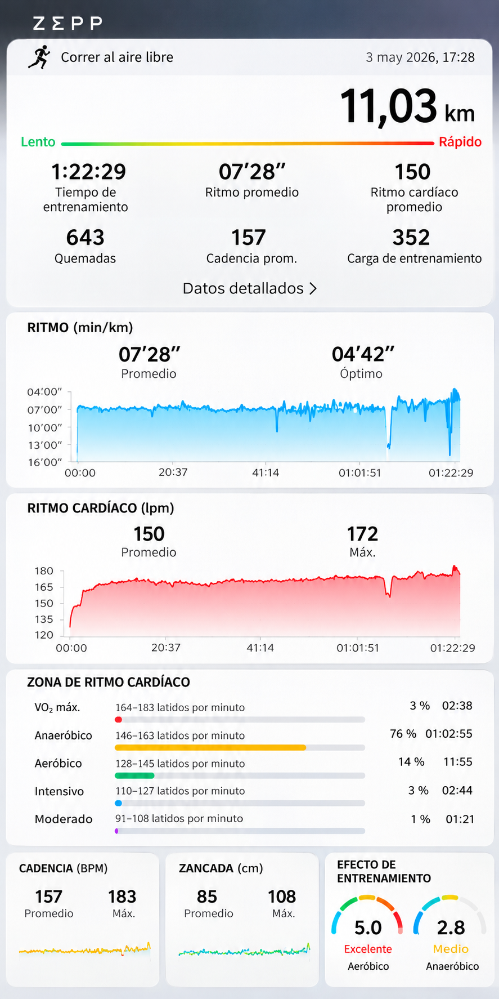
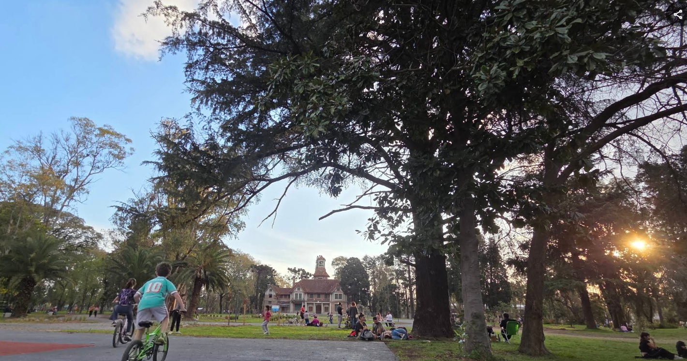

# 01 - Requerimientos de My Running

## 1. Origen del proyecto

La idea de desarrollar My Running surgió a partir de una experiencia cercana con el running y de la necesidad de organizar la información de los entrenamientos.

Cuando una persona comienza a correr, generalmente presta atención a cuántos kilómetros puede recorrer. Sin embargo, a medida que avanza, empieza a observar otros datos: cuánto tiempo tarda, qué ritmo mantiene, qué distancias puede completar y en qué lugares entrena.

Al analizar distintos registros de entrenamientos, observamos que no siempre resulta sencillo comparar los resultados. Una salida de 5 kilómetros puede tener un ritmo mejor que otra de 10 kilómetros, aunque el tiempo total sea menor.

A partir de esta situación, decidimos desarrollar My Running, una aplicación que nos permita trabajar con información relacionada con el running y, al mismo tiempo, aplicar los contenidos de la materia Estructuras de Datos y Algoritmos.

Nuestra intención fue crear un proyecto que tuviera relación con una actividad real y que pudiera ampliarse a medida que incorporábamos nuevas estructuras de datos.

## 2. Descripción del proyecto

My Running es una aplicación desarrollada en Python que funciona desde la terminal mediante un menú de opciones.

El programa permite registrar entrenamientos, consultar recorridos y organizar información utilizando diferentes estructuras de datos.

Durante el desarrollo fuimos incorporando nuevas funcionalidades según los temas trabajados en la materia.

Por ejemplo, utilizamos árboles para organizar y consultar recorridos, y un Heap para obtener un ranking de los mejores entrenamientos según su ritmo.

De esta manera, las estructuras de datos no se utilizan solamente como ejercicios aislados, sino que cumplen una función dentro de una misma aplicación.

## 3. Análisis de entrenamientos reales

Para relacionar el proyecto con una situación concreta, tomamos como referencia siete entrenamientos registrados mediante la aplicación Zepp.

Estos registros corresponden a distintas salidas de running y contienen información como distancia, tiempo total y ritmo promedio.

| Entrenamiento | Distancia | Tiempo | Ritmo promedio |
|---|---|---|---|
| 1 | 11,03 km | 1:22:29 | 7:28 min/km |
| 2 | 8,02 km | 52:57 | 6:35 min/km |
| 3 | 7,35 km | 48:53 | 6:38 min/km |
| 4 | 8,07 km | 56:26 | 6:59 min/km |
| 5 | 4,60 km | 34:31 | 7:29 min/km |
| 6 | 8,03 km | 57:34 | 7:09 min/km |
| 7 | 4,90 km | 30:28 | 6:12 min/km |

*Fuente: registros personales de entrenamientos obtenidos de Zepp. Los valores se transcribieron de las capturas originales.*

### ¿Por qué es importante el ritmo?

El ritmo promedio indica cuánto tiempo tarda una persona en recorrer un kilómetro. Habitualmente se expresa en minutos y segundos por kilómetro (min/km).

Por ejemplo, un entrenamiento de 5 kilómetros realizado en 30 minutos tiene un ritmo promedio de 6:00 min/km.

Esto permite comparar entrenamientos de distintas distancias sin depender solamente del tiempo total.

En My Running decidimos utilizar el ritmo como criterio para ordenar los mejores entrenamientos.

Cuanto menor sea el tiempo por kilómetro, mejor será la posición en el ranking.

### Relación con el Heap

Al incorporar el TP6, implementamos un Min-Heap para organizar entrenamientos según su ritmo.

Elegimos esta estructura porque permite mantener accesible el entrenamiento con menor ritmo y extraer los mejores resultados según su prioridad.

Por ejemplo, al considerar los siete registros anteriores, los tres mejores ritmos son:

1. 4,90 km — 6:12 min/km.
2. 8,02 km — 6:35 min/km.
3. 7,35 km — 6:38 min/km.

Este ejemplo nos permitió relacionar una estructura de datos estudiada en clase con una necesidad concreta del proyecto.

## 4. Recorridos que tomamos como referencia

Para My Running elegimos tres lugares de nuestra zona que ofrecen diferentes posibilidades para salir a correr. La idea fue trabajar con recorridos reales y no solamente con ejemplos inventados.

### Longchamps – Villa París

Este es uno de los recorridos que utilizamos como referencia a partir de la experiencia personal de una integrante del grupo.

El trayecto pasa por Boulevard Yapeyú, Avenida República Argentina y Avenida Juan B. Justo. Una de sus ventajas es que podemos adaptar la distancia según el entrenamiento: algunos días hacemos recorridos más cortos y otros extendemos el trayecto.

También utilizamos Google Maps para medir distintas alternativas y comparar las distancias aproximadas.

### Parque Finky – Turdera

Elegimos Parque Finky porque es un espacio que permite correr dando vueltas a un circuito, sin necesidad de recorrer calles y avenidas.

Además, cuenta con espacios para realizar ejercicios y baños públicos.

Nos pareció una buena alternativa para incluir en My Running porque permite organizar entrenamientos según la cantidad de vueltas y la distancia que queremos completar.

### Quinta Rocca – Burzaco

También elegimos Quinta Rocca porque es uno de los espacios verdes de nuestra zona que ofrece una alternativa para salir a correr o caminar.

Cuenta con caminos rodeados de árboles, sectores amplios para realizar actividad física y baños públicos.

Nos interesó incorporarlo porque permite ofrecer otra opción de entrenamiento, diferente a los recorridos por calles y avenidas.

### ¿Por qué elegimos estos lugares?

Al comparar los tres recorridos, observamos que no todos ofrecen las mismas posibilidades. En algunos podemos modificar la distancia avanzando por diferentes calles, mientras que en otros podemos sumar kilómetros dando vueltas a un circuito.

Esta diferencia nos ayudó a pensar cómo organizar los recorridos dentro de My Running y qué información podría resultar útil para quienes utilizan la aplicación.

## 5. Objetivo general

Desarrollar una aplicación en Python que permita organizar entrenamientos y recorridos de running, consultar resultados y aplicar las estructuras de datos y los algoritmos estudiados durante la cursada.

### Objetivos específicos

- Registrar entrenamientos con sus datos principales.
- Consultar recorridos disponibles.
- Organizar recorridos mediante diferentes tipos de árboles.
- Explorar recorridos agrupados por dificultad, lugar y distancia.
- Obtener un ranking de los mejores ritmos.
- Realizar pruebas para comprobar el funcionamiento de las estructuras.
- Comparar algoritmos y analizar sus tiempos de ejecución.
- Documentar el desarrollo y los resultados obtenidos.

## 6. Requerimientos funcionales

Los requerimientos funcionales describen las acciones que debe permitir My Running.

**RF01 - Registro de entrenamientos**

El programa debe permitir registrar entrenamientos indicando información como lugar, distancia y tiempo.

**RF02 - Consulta de recorridos**

El usuario debe poder consultar los recorridos disponibles para realizar sus entrenamientos.

**RF03 - Organización mediante árboles**

El programa debe permitir organizar y consultar recorridos utilizando árboles binarios de búsqueda, árboles AVL y árboles generales.

**RF04 - Exploración por categorías**

El usuario debe poder explorar recorridos agrupados según dificultad, lugar y distancia.

**RF05 - Ranking de mejores ritmos**

El programa debe permitir obtener los tres mejores entrenamientos según el ritmo, utilizando un Min-Heap.

**RF06 - Menú de navegación**

El usuario debe poder acceder a las funcionalidades mediante un menú de opciones en la terminal.

**RF07 - Pruebas y comparación de algoritmos**

El proyecto debe incluir pruebas que permitan comprobar el funcionamiento de las estructuras de datos y comparar su rendimiento.

## 7. Requerimientos no funcionales

**RNF01 - Lenguaje de programación**

La aplicación debe desarrollarse en Python.

**RNF02 - Interfaz de usuario**

El programa debe funcionar desde la terminal mediante una interfaz de texto.

**RNF03 - Organización del código**

El código debe distribuirse en archivos y clases que faciliten su comprensión y mantenimiento.

**RNF04 - Documentación**

El proyecto debe contar con documentación que explique las funcionalidades, las estructuras utilizadas, las pruebas y las conclusiones.

**RNF05 - Control de versiones**

El desarrollo debe mantenerse en GitHub para registrar los cambios y permitir el trabajo colaborativo.

**RNF06 - Pruebas de funcionamiento**

Las estructuras y funcionalidades implementadas deben poder verificarse mediante pruebas de ejecución.

## 8. Alcance del proyecto

### Funcionalidades implementadas

Hasta el TP6, My Running incorpora:

- Registro de entrenamientos.
- Consulta de recorridos.
- Organización de recorridos mediante árboles.
- Exploración de categorías mediante un árbol general.
- Ranking de los tres mejores ritmos mediante un Min-Heap.
- Pruebas de funcionamiento y comparaciones de rendimiento.

### Limitaciones actuales

El programa funciona desde la terminal y no cuenta con una interfaz gráfica.

Los entrenamientos registrados durante una ejecución se mantienen en memoria, por lo que no se conservan automáticamente cuando se cierra el programa.

Tampoco se conecta directamente con relojes deportivos ni importa automáticamente los registros de Zepp.

Los datos utilizados en las pruebas deben incorporarse manualmente o mediante los archivos de prueba.

### Funcionalidades pendientes

El proyecto continuará ampliándose de acuerdo con las siguientes etapas del trabajo integrador, que incluyen el estudio de grafos y algoritmos de recorridos y caminos mínimos.

Estas funcionalidades se documentarán cuando estén implementadas y probadas.

## 9. Usuarios del sistema

My Running está pensado principalmente para personas que practican running y desean organizar sus entrenamientos, consultar recorridos y comparar sus resultados.

También funciona como un proyecto educativo que permite demostrar cómo diferentes estructuras de datos pueden resolver problemas dentro de una misma aplicación.

## 10. Evidencias del proyecto

Para acompañar la documentación, reunimos registros reales de entrenamientos y resultados de las pruebas realizadas en Python.

### Evidencia 01 - Entrenamiento de 11,03 km

*Imagen ilustrativa basada en un entrenamiento real registrado en Zepp. No corresponde a una captura original de la aplicación.*

Los datos originales de distancia, tiempo y ritmo se presentan en la tabla de la sección 3.

También incorporaremos capturas de la terminal que permitan observar cómo el programa registra entrenamientos, organiza recorridos y muestra el ranking.

### Evidencia 02 - Investigación de recorridos

Para elegir los recorridos utilizamos nuestra experiencia y consultamos imágenes y mapas de los lugares seleccionados.

En el caso de Longchamps, medimos diferentes trayectos con Google Maps para observar cómo cambia la distancia según el recorrido.

Para Quinta Rocca, consultamos fotografías del lugar que muestran sus espacios verdes y caminos.

*Fuente de las fotografías de Quinta Rocca: [Google Maps – Quinta Rocca](https://maps.app.goo.gl/EQmJHUeJpeTgTjUNA).*

## 11. Conclusión

My Running nos permitió relacionar los contenidos de Estructuras de Datos y Algoritmos con una actividad concreta.

A partir de registros de running, pudimos identificar necesidades como organizar recorridos y comparar entrenamientos, y buscar estructuras que nos ayudaran a resolverlas.

Durante el desarrollo también comprobamos que no todas las estructuras sirven para lo mismo. Los árboles nos permiten organizar y consultar recorridos, mientras que el Heap nos ayuda a trabajar con prioridades.

El proyecto continúa en desarrollo, pero las etapas realizadas hasta el TP6 nos permitieron poner en práctica los conceptos estudiados y comprobar su funcionamiento mediante pruebas.
