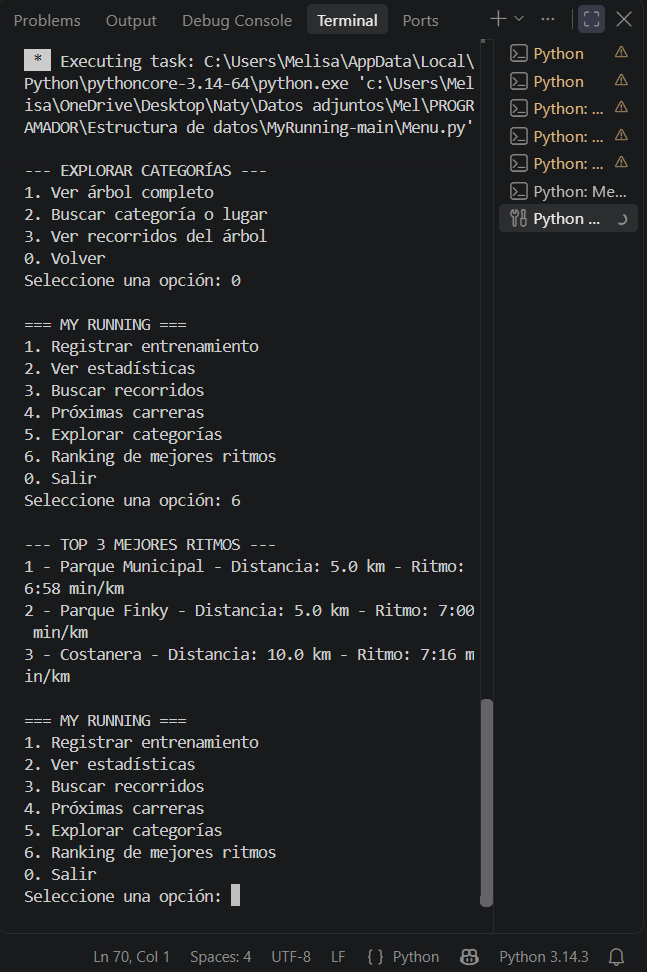

# 03 - Pruebas de funcionamiento de My Running

## 1. ¿Por qué realizamos estas pruebas?

Después de incorporar las distintas funcionalidades de My Running, decidimos ejecutar el programa completo para comprobar cómo funcionaban las opciones del menú.

Hasta ese momento habíamos trabajado con diferentes estructuras de datos y archivos de prueba. Sin embargo, también necesitábamos verificar que las funcionalidades estuvieran conectadas correctamente y que los datos registrados pudieran utilizarse en otras partes del programa.

Para realizar estas comprobaciones utilizamos Visual Studio Code, ejecutando el archivo `Menu.py` y probando las opciones desde la terminal.

## 2. Pruebas realizadas

### Prueba 1 - Registro de entrenamientos

Seleccionamos la opción 1 del menú e ingresamos un entrenamiento con los siguientes datos:

| Dato | Valor |
|---|---|
| Fecha | 12/11/2026 |
| Distancia | 5 km |
| Tiempo | 35 minutos |
| Lugar | Parque Finky |

**Resultado esperado:** que el programa agregara el entrenamiento y mostrara un mensaje de confirmación.

**Resultado obtenido:** apareció el mensaje «¡Entrenamiento guardado con éxito!».

El programa regresó al menú principal sin mostrar errores.

### Prueba 2 - Estadísticas

Después de registrar el entrenamiento anterior, seleccionamos la opción 2 para consultar las estadísticas.

El programa tenía inicialmente dos entrenamientos de ejemplo, de 5 y 10 kilómetros. Al agregar el nuevo entrenamiento, esperábamos obtener tres registros y un total de 20 kilómetros.

**Resultado obtenido:**

- Total de entrenamientos: 3.
- Kilómetros acumulados: 20 km.

Esto permitió comprobar que el entrenamiento se había incorporado a la lista y que el programa utilizaba esos datos para actualizar las estadísticas.

### Prueba 3 - Búsqueda de recorridos

Seleccionamos la opción 3 e ingresamos una distancia de 5 kilómetros.

El programa utiliza un árbol binario de búsqueda para encontrar recorridos que coincidan con la distancia solicitada.

**Resultado obtenido:**

| Recorrido | Distancia | Dificultad |
|---|---|---|
| Parque Finky | 5 km | Media |
| Parque de Lomas | 5 km | Fácil |
| Polideportivo de Burzaco | 5 km | Media |
| Parque Ramón Carrillo | 5 km | Media |

La búsqueda devolvió cuatro recorridos.

Con esta prueba comprobamos que el árbol puede encontrar una distancia y devolver varios recorridos que comparten ese mismo valor.

### Prueba 4 - Exploración de categorías

Seleccionamos la opción 5 del menú y luego «Ver árbol completo».

El programa mostró los recorridos organizados de la siguiente manera:

**Recorridos → Dificultad → Lugar → Distancia**

Observamos dos categorías principales: Fácil y Media. Dentro de cada una aparecían los lugares correspondientes y sus distancias disponibles.

Después utilizamos la opción «Buscar categoría o lugar» e ingresamos la palabra `finky`.

**Resultado obtenido:**

- Recorridos → Fácil → Parque Finky → 3 km.
- Recorridos → Media → Parque Finky → 5 km.

La búsqueda funcionó aunque escribimos el nombre en minúsculas.

Esta prueba permitió comprobar que el árbol general no solamente muestra las categorías, sino que también permite buscar lugares y recuperar los recorridos relacionados.

### Prueba 5 - Ranking de mejores ritmos

Seleccionamos la opción 6 para consultar los tres mejores entrenamientos.

El programa utiliza un Min-Heap para organizar los entrenamientos según su ritmo promedio.

Como habíamos registrado un entrenamiento nuevo de 5 km en 35 minutos, queríamos comprobar si también participaba del ranking.

**Resultado obtenido:**

| Puesto | Lugar | Distancia | Ritmo |
|---|---|---|---|
| 1 | Parque Municipal | 5 km | 6:58 min/km |
| 2 | Parque Finky | 5 km | 7:00 min/km |
| 3 | Costanera | 10 km | 7:16 min/km |

**Evidencia de la prueba:**

El entrenamiento registrado durante la prueba apareció en el segundo puesto.

Comprobamos que el programa ordenaba los resultados correctamente, considerando que un ritmo menor representa un entrenamiento más rápido.

Esta prueba también nos permitió verificar que los entrenamientos registrados desde el menú se utilizan en otras funcionalidades.

### Prueba 6 - Próximas carreras

Al seleccionar la opción 4, observamos que el programa mostraba dos carreras cuyas fechas ya habían pasado.

Las carreras cargadas inicialmente eran:

- Maratón de la Ciudad: 15/10/2026.
- Carrera de las Luces: 02/11/2026.

Como estábamos realizando las pruebas el 12 de noviembre de 2026, consideramos que esa información debía actualizarse.

Buscamos dos carreras reales y reemplazamos los datos anteriores en `Menu.py`.

**Carreras incorporadas:**

| Carrera | Fecha | Distancia |
|---|---|---|
| Circuito de las Estaciones - Verano | 20/12/2026 | 10 km |
| San Silvestre Buenos Aires Carnaval | 31/12/2026 | 8 km |

También agregamos los lugares de largada informados para cada evento.

Después ejecutamos nuevamente el programa y comprobamos que la opción 4 mostraba los datos actualizados.

**Fuentes consultadas:**

- [Circuito de las Estaciones - Club de Corredores](https://www.clubdecorredores.com/carreras/535/Circuito-de-las-Estaciones/)
- [San Silvestre Buenos Aires 2026](https://sansilvestrebuenosaires.com/2026/)

Actualmente, las carreras se cargan manualmente en el código. El programa no consulta automáticamente calendarios ni páginas de eventos.

## 3. Resumen de resultados

| Funcionalidad | Resultado |
|---|---|
| Registrar entrenamiento | Correcto |
| Consultar estadísticas | Correcto |
| Buscar recorridos por distancia | Correcto |
| Mostrar árbol general | Correcto |
| Buscar categorías o lugares | Correcto |
| Ranking de mejores ritmos | Correcto |
| Mostrar próximas carreras | Correcto, después de actualizar los datos |

Las pruebas realizadas permitieron comprobar el funcionamiento de las principales opciones del menú con los datos utilizados.

## 4. Observaciones y limitaciones

Durante las pruebas también identificamos algunos aspectos que debemos tener presentes:

**Almacenamiento de entrenamientos**

Los entrenamientos registrados se mantienen en memoria durante la ejecución del programa. Al cerrarlo y volver a iniciarlo, los registros agregados no se recuperan automáticamente.

**Validación de datos**

En estas pruebas utilizamos valores válidos. Todavía queda comprobar cómo responde el programa ante entradas incorrectas, como letras en lugar de números o distancias negativas.

**Próximas carreras**

La información se actualiza manualmente. Por lo tanto, es necesario revisar las fechas para evitar que se muestren carreras que ya finalizaron.

**Recorridos disponibles**

Los recorridos y las distancias están cargados en el código. Actualmente no existe una opción en el menú para agregar nuevos recorridos.

Estas observaciones nos permiten identificar posibles mejoras sin confundirlas con funcionalidades que ya están implementadas.

## 5. Conclusión

Las pruebas nos permitieron comprobar que las principales funcionalidades de My Running trabajan de manera integrada.

Pudimos registrar un entrenamiento, verificar que se sumara a las estadísticas y observar cómo participaba en el ranking de mejores ritmos.

También comprobamos el funcionamiento de las búsquedas mediante árboles y la organización de recorridos por categorías.

Durante este proceso detectamos que las carreras mostradas estaban desactualizadas. Corregimos esa información y volvimos a ejecutar el programa para verificar el cambio.

Consideramos que estas pruebas fueron importantes porque nos permitieron observar el funcionamiento real de My Running, detectar aspectos para mejorar y reunir evidencias del trabajo realizado por el grupo.
