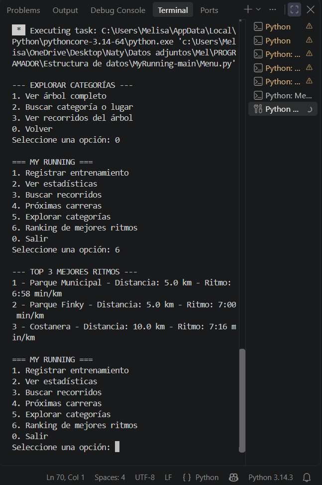

# 04 - Implementación y pruebas de Dijkstra (TP 9)

## 1. ¿Qué incorporamos en esta etapa?

Después de trabajar con grafos en el TP 7 y con los algoritmos BFS y DFS en el TP 8, continuamos desarrollando My Running incorporando el algoritmo de Dijkstra.

Nuestro objetivo fue aprovechar el grafo de recorridos que ya teníamos implementado para encontrar una progresión entre dos recorridos con el menor costo acumulado.

Para hacerlo, agregamos un nuevo método a la clase `GrafoRecorridos` y una opción al menú principal.

## 2. ¿Cómo funciona Dijkstra en My Running?

El grafo de My Running está formado por recorridos que tienen un identificador, un nombre, una distancia y una dificultad.

En el TP 7 establecimos que dos recorridos se conectaran cuando la diferencia entre sus distancias fuera de hasta 2 kilómetros.

Para implementar Dijkstra decidimos utilizar esa misma diferencia como costo de cada conexión.

Por ejemplo, pasar de un recorrido de 3 km a otro de 5 km tiene un costo de 2.

De esta manera, el algoritmo busca una secuencia de recorridos conectados cuya suma de diferencias sea la menor posible.

Es importante aclarar que el costo no representa el traslado físico entre parques. Se utiliza como criterio para comparar progresiones entre distancias de entrenamiento.

## 3. Archivos modificados

Para incorporar esta funcionalidad trabajamos sobre tres archivos:

| Archivo | Trabajo realizado |
|---|---|
| `grafo_recorridos.py` | Agregamos el método `dijkstra()`. |
| `Menu.py` | Incorporamos la opción 9 para utilizar Dijkstra desde el programa principal. |
| `prueba_dijkstra.py` | Creamos una prueba independiente para comprobar el algoritmo. |

Mantuvimos los métodos anteriores del grafo, incluyendo BFS y DFS.

## 4. Primera prueba: recorridos de ejemplo

Antes de modificar el menú principal, creamos el archivo `prueba_dijkstra.py`.

En esta prueba utilizamos tres recorridos:

| Recorrido | Distancia |
|---|---|
| A | 3 km |
| B | 5 km |
| C | 7 km |

Agregamos los tres recorridos al grafo y los conectamos utilizando el criterio de similitud de distancia.

Después ejecutamos Dijkstra desde el recorrido A hasta el recorrido C.

**Resultado obtenido:**

    Camino encontrado: [1, 2, 3]
    Costo total: 4.0

El algoritmo encontró el camino A → B → C.

La diferencia entre A y B es de 2 km, y entre B y C también es de 2 km. Por lo tanto, el costo total es 4.

Esta primera prueba nos permitió comprobar que el método devolvía un camino y su costo acumulado.

## 5. Integración al menú principal

Una vez que comprobamos el funcionamiento inicial, incorporamos Dijkstra al archivo `Menu.py`.

Agregamos la opción:

**9. Buscar progresión de menor costo**

Al seleccionarla, el programa muestra los recorridos disponibles con sus identificadores y distancias.

El usuario debe ingresar el número del recorrido inicial y el número del recorrido final.

Después, el programa utiliza el método `dijkstra()` para buscar el camino de menor costo y mostrar los recorridos que forman parte de esa progresión.

## 6. Segunda prueba: recorridos de My Running

Para comprobar el funcionamiento desde el menú principal, realizamos una prueba utilizando recorridos cargados en el programa.

Seleccionamos:

- **Recorrido inicial:** 2 - Quinta Rocca - UNaB, 3 km.
- **Recorrido final:** 13 - Circuito urbano de Longchamps, 8 km.

**Resultado obtenido:**

    --- CAMINO ENCONTRADO ---
    - Quinta Rocca - UNaB - 3.0 km
    - Parque Finky - 5.0 km
    - Parque de Lomas - 7.0 km
    - Circuito urbano de Longchamps - 8.0 km

    Costo total: 5.0 km de diferencia acumulada

El programa encontró una progresión que pasa por recorridos de 3, 5, 7 y 8 kilómetros.

Calculamos el costo acumulado:

- De 3 a 5 km: diferencia de 2 km.
- De 5 a 7 km: diferencia de 2 km.
- De 7 a 8 km: diferencia de 1 km.

**Costo total: 2 + 2 + 1 = 5 km.**

El resultado coincide con el menor costo posible para pasar de una distancia de 3 km a otra de 8 km utilizando estas conexiones.

### Evidencia de la prueba

## 7. Tercera prueba: recorrido inexistente

También quisimos comprobar qué sucedía cuando se ingresaba un recorrido que no existía.

Para esta prueba seleccionamos un destino con identificador **99**, que no está cargado en el grafo.

El programa mostró:

    No existe un camino entre los recorridos.

Después regresó al menú principal sin cerrarse ni mostrar errores.

Esta prueba permitió verificar que el programa contempla identificadores inexistentes y puede continuar funcionando.

## 8. Diferencia entre BFS y Dijkstra

Aunque ambos algoritmos permiten buscar caminos dentro de un grafo, tienen objetivos diferentes.

**BFS**, que incorporamos en el TP 8, busca un camino con la menor cantidad de conexiones.

**Dijkstra**, incorporado en el TP 9, busca un camino cuyo costo total sea el menor posible.

En nuestro proyecto, ese costo se calcula utilizando la diferencia de kilómetros entre recorridos conectados.

Por eso, Dijkstra no necesariamente elige el camino con menos conexiones, sino el que tiene el menor costo acumulado.

## 9. Complejidad del algoritmo

Nuestra implementación utiliza un conjunto de vértices pendientes y selecciona el siguiente vértice mediante `min()`.

Esto significa que, para elegir el próximo recorrido, el algoritmo revisa los vértices que todavía no procesó.

En esta versión, la complejidad temporal es **O(V² + E)**, donde:

- **V** representa la cantidad de vértices o recorridos.
- **E** representa la cantidad de aristas o conexiones.

Para la cantidad de recorridos que utilizamos actualmente, esta implementación resulta suficiente.

Como posible mejora, podríamos utilizar una cola de prioridad para hacer más eficiente la selección del siguiente vértice.

## 10. Observaciones y posibles mejoras

Durante el desarrollo identificamos algunas características de nuestra implementación:

- El algoritmo utiliza los recorridos y conexiones que ya estaban cargados en el grafo.
- El costo se calcula a partir de la diferencia entre las distancias de los recorridos.
- Los recorridos se encuentran conectados por similitud de distancia, no por cercanía geográfica.
- El programa permite consultar la progresión desde el menú principal.
- Si se ingresa un identificador inexistente, muestra un mensaje y regresa al menú.

Como mejora futura, podríamos incorporar otros criterios de costo, como la dificultad de los recorridos, para ofrecer recomendaciones más personalizadas.

## 11. Conclusión

En el TP 9 incorporamos Dijkstra a My Running aprovechando el grafo que habíamos desarrollado anteriormente.

Primero probamos el algoritmo con tres recorridos de ejemplo y después lo integramos al menú principal para utilizarlo con los recorridos del programa.

Realizamos pruebas con un camino válido y con un identificador inexistente. En ambos casos, el programa respondió de acuerdo con lo esperado.

Este trabajo nos permitió integrar una nueva funcionalidad sin reemplazar las estructuras anteriores y seguir avanzando hacia la versión final de My Running.
